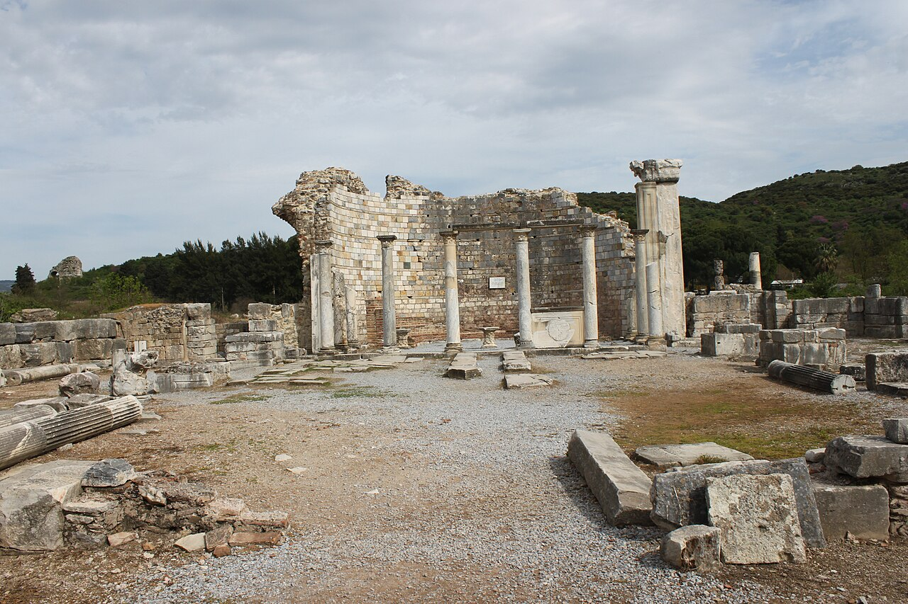

{fig-alt="Ruins of the Church of Mary in Ephesus"}

The acts of the Third Ecumenical Council of Ephesus (431) are the principal source for the first phase of the Christological controversies of the fifth century. Eduard Schwartz edited them in 1923–29 as the first major volume of the *Acta Conciliorum Oecumenicorum* (ACO): almost 1,800 pages of Greek and Latin texts, arranged by the collections in which they were transmitted rather than chronologically.

The long-term project (2016–2026) of the Department of Church History at the University of Bonn, funded by the German Research Foundation (DFG), translates the acts in full into a modern language for the first time, arranges them chronologically, and provides introductions and a commentary covering theological, historical and philological questions. The results are published in print and in digital form.

Digital Humanities Bern is responsible for the technical implementation of the digital edition. The TEI data are processed with XSLT and published in a SvelteKit application: document view with critical apparatus, indices of persons and places, an index of biblical references, a list of abbreviations, and visualisations (network explorer, Sankey diagram of biblical references by document, geo map). The edition is currently under construction.

## Participants

- University of Bonn, Faculty of Protestant Theology, Department of Church History: Prof. Dr. Wolfram Kinzig, Dr. Thomas Brüggemann (head of the research unit), Dr. Sabine Lütkemeyer, Dr. Julia Beier
- Digital Humanities, University of Bern: technical implementation

Funded by the Deutsche Forschungsgemeinschaft (DFG, project number 282331637).
